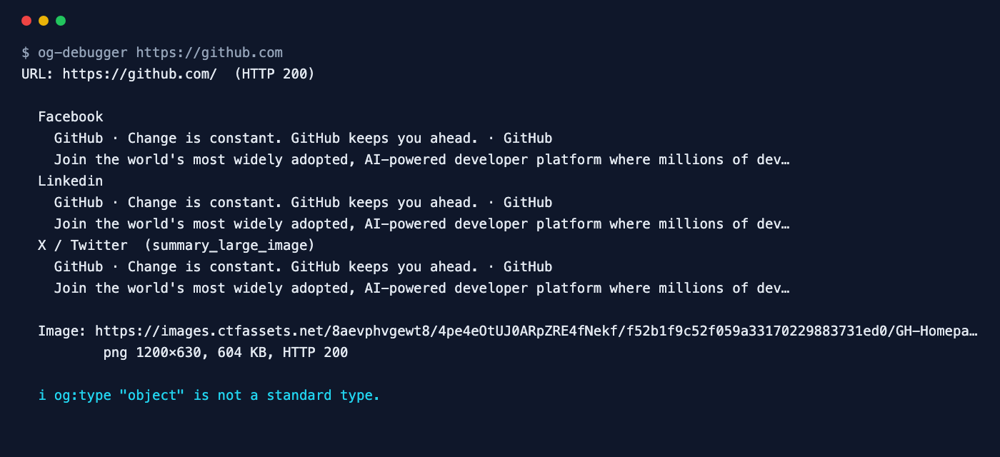

<div align="center">

# Open Graph Debugger

**See how your link will look on Facebook, LinkedIn and X — before you share it.**

[](https://github.com/ksanyok/og-debugger/actions/workflows/ci.yml) [](LICENSE)   [](https://promopilot.link/en/tools/og-debugger.php?utm_source=github&utm_medium=repo&utm_campaign=tools&utm_content=og-debugger)

**[▶ Use the free online version — no install, no sign-up](https://promopilot.link/en/tools/og-debugger.php?utm_source=github&utm_medium=repo&utm_campaign=tools&utm_content=og-debugger)**

</div>

`og-debugger` requests a page with the Facebook crawler's user agent, reads every `og:`, `twitter:` and `article:` tag and works out what Facebook, LinkedIn and X will actually show — including the fallbacks each platform uses when a tag is missing. Then it downloads the share image and checks what breaks previews most often: a relative or broken URL, a format platforms do not accept, an image smaller than 200×200 or not 1.91:1, and files over the 5 MB / 8 MB limits.



## What it checks

- Required Open Graph tags: `og:title`, `og:type`, `og:image`, `og:url`, plus `og:description`
- What Facebook, LinkedIn and X display, including fallbacks to `<title>`, meta description and `og:*` when `twitter:*` tags are missing
- The share image: absolute https URL, HTTP 200, real format (PNG, JPEG, GIF, WebP) and dimensions read from the file itself
- Image size and shape: at least 200×200, 1200×630 recommended, 1.91:1 ratio, under 5 MB (X) / 8 MB (Facebook)
- `og:url` that differs from the canonical URL (shares and likes split between two URLs)
- Overlong titles, non-standard `og:type`, duplicated tags, missing `twitter:card`
- The HTTP status the page returns to the crawler user agent

## Why it matters

Every link to your site shared in a chat, post or newsletter is rendered from these tags. When they are missing or broken the link shows up as a bare URL or with a random image from the page — and the click-through rate drops. Platforms cache what they see the first time, so a mistake at launch sticks around. The usual causes are invisible in the browser: a relative image URL, a CDN that blocks the crawler, an image that is too small, or a plugin that prints the tags twice.

## Quick start

```bash
# run straight from GitHub, nothing to install
npx github:ksanyok/og-debugger example.com

# or install the CLI globally
npm install -g github:ksanyok/og-debugger
og-debugger example.com
```

Check a page before announcing it:

```bash
og-debugger https://example.com/blog/launch
```

List every social tag:

```bash
og-debugger example.com --all
```

Check a local build (tags only):

```bash
og-debugger --file dist/blog/launch/index.html
```

## Example output

```text
$ og-debugger https://github.com
URL: https://github.com/  (HTTP 200)

  Facebook
    GitHub · Change is constant. GitHub keeps you ahead. · GitHub
    Join the world's most widely adopted, AI-powered developer platform where millions of dev…
  Linkedin
    GitHub · Change is constant. GitHub keeps you ahead. · GitHub
    Join the world's most widely adopted, AI-powered developer platform where millions of dev…
  X / Twitter  (summary_large_image)
    GitHub · Change is constant. GitHub keeps you ahead. · GitHub
    Join the world's most widely adopted, AI-powered developer platform where millions of dev…

  Image: https://images.ctfassets.net/8aevphvgewt8/4pe4eOtUJ0ARpZRE4fNekf/f52b1f9c52f059a33170229883731ed0/GH-Homepage-Universe-img.png
          png 1200×630, 604 KB, HTTP 200

  i og:type "object" is not a standard type.
```

## CLI

```text
Usage: og-debugger <url> [options]
       og-debugger --file page.html

Fetches a page as the Facebook crawler, reads its Open Graph and Twitter Card
tags, downloads the share image (size, format, weight) and shows what
Facebook, LinkedIn and X will display.

Options:
  --file <path>     Analyse a local HTML file (no image download)
  --ua <agent>      User agent to send (default: facebookexternalhit)
  --no-image        Do not download the image
  --all             Print every og:/twitter:/article: tag
  --json            Print JSON
  --strict          Exit with code 1 on warnings too
  -h, --help        Show this help

Online version (no install): https://promopilot.link/en/tools/og-debugger.php
```

## Use as a library

```js
import { checkOpenGraph, extractSocial, previews } from '@promopilot/og-debugger';

const r = await checkOpenGraph('https://example.com/post');
console.log(r.previews.facebook, r.image, r.issues);

// Offline
const s = extractSocial(html, 'https://example.com/post');
previews(s).x; // { card, title, description, image }
```

`checkOpenGraph(url, { fetch, userAgent, checkImage })` returns `{ url, finalUrl, status, og, twitter, title, description, canonical, images[], image, previews, issues[], ok }`. `image` contains `status`, `contentType`, `bytes`, `type`, `width` and `height`. Issue codes are stable (`missing-image`, `image-too-small`, `image-broken`, `url-canonical-mismatch`, `duplicate-tag`, …).

## Use in CI (GitHub Actions)

Make sure every new blog post ships with a working share image:

```yaml
on: [deployment_status]
jobs:
  og:
    runs-on: ubuntu-latest
    steps:
      - uses: ksanyok/og-debugger@v1
        with:
          args: https://example.com/blog/latest --strict
```

## How it works

The page is fetched with Node's built-in `fetch` using the `facebookexternalhit` user agent (configurable), because some sites serve crawlers different HTML. Tags are read from `<head>` after removing comments and scripts. The share image is downloaded and its dimensions are read from the file header bytes (PNG IHDR, JPEG SOF, GIF and WebP headers) — no image library needed. Previews apply each platform's fallback order: X uses `twitter:*`, then `og:*`; Facebook and LinkedIn use `og:*`, then the title and meta description.

## CLI vs. online version

| | This package | [Online tool](https://promopilot.link/en/tools/og-debugger.php?utm_source=github&utm_medium=repo&utm_campaign=tools&utm_content=og-debugger) |
|---|---|---|
| Runs on | Your machine, CI | Any browser |
| Local HTML | Yes, `--file` | Published pages |
| Previews | Text previews per platform | Visual cards for each platform |
| Output | Text, JSON, exit codes | Visual report with fixes |
| Price | Free, MIT | Free, no sign-up |


## FAQ

<details>
<summary><b>I fixed the tags but Facebook still shows the old preview</b></summary>

Platforms cache previews. After fixing, ask Facebook to re-scrape the URL in its Sharing Debugger; LinkedIn has a Post Inspector. X refreshes its cache within about a week.
</details>

<details>
<summary><b>What is the best og:image size?</b></summary>

1200×630 pixels (1.91:1), PNG or JPEG, under 5 MB. It looks sharp on high-density screens and is not cropped on any major platform.
</details>

<details>
<summary><b>Do I need Twitter Card tags if I have Open Graph?</b></summary>

X falls back to Open Graph for title, description and image, but you need `twitter:card` = `summary_large_image` to get the large image layout.
</details>

<details>
<summary><b>Can og:image be an SVG?</b></summary>

No. Facebook, LinkedIn and X do not render SVG previews. Use PNG or JPEG.
</details>

<details>
<summary><b>Why does the tool use the Facebook user agent?</b></summary>

Some sites (and bot protection) respond differently to crawlers. Testing as the crawler shows what it will really get. Use `--ua` to test another one.
</details>

<details>
<summary><b>Is there a version without installing anything?</b></summary>

Yes — the [online Open Graph Debugger](https://promopilot.link/en/tools/og-debugger.php?utm_source=github&utm_medium=repo&utm_campaign=tools&utm_content=og-debugger) runs the same checks in the browser and explains each result.
</details>

## Related free tools

- [Meta Tag Analyzer](https://promopilot.link/en/tools/meta-analyzer.php?utm_source=github&utm_medium=repo&utm_campaign=tools&utm_content=meta-analyzer) — title, description, canonical, robots and Open Graph
- [SERP Preview](https://promopilot.link/en/tools/serp-preview.php?utm_source=github&utm_medium=repo&utm_campaign=tools&utm_content=serp-preview) — see how a title and description look in Google
- [Schema Validator](https://promopilot.link/en/tools/schema-validator.php?utm_source=github&utm_medium=repo&utm_campaign=tools&utm_content=schema-validator) — check JSON-LD structured data
- [Favicon Checker](https://promopilot.link/en/tools/favicon-checker.php?utm_source=github&utm_medium=repo&utm_campaign=tools&utm_content=favicon-checker) — every icon, manifest and size a browser looks for
- [UTM Builder](https://promopilot.link/en/tools/utm-builder.php?utm_source=github&utm_medium=repo&utm_campaign=tools&utm_content=utm-builder) — tag campaign links consistently
- [All 120+ free SEO, email and web tools](https://promopilot.link/en/tools/?utm_source=github&utm_medium=repo&utm_campaign=tools&utm_content=og-debugger)

## Contributing

Bug reports and pull requests are welcome — see [CONTRIBUTING.md](CONTRIBUTING.md). Security issues: [SECURITY.md](SECURITY.md).
More docs live in the [wiki](https://github.com/ksanyok/og-debugger/wiki) (sources in [docs/wiki](docs/wiki)).

## License

[MIT](LICENSE) © 2026 Alexandr Krikun

---

<sub>Built and maintained by the team behind [PromoPilot](https://promopilot.link/?utm_source=github&utm_medium=repo&utm_campaign=tools&utm_content=og-debugger) — link building, SEO monitoring and 120+ free tools for site owners. Also on [YouTube](https://www.youtube.com/channel/UCPB8m7BgaexcZh0Vr49ViYA).</sub>
